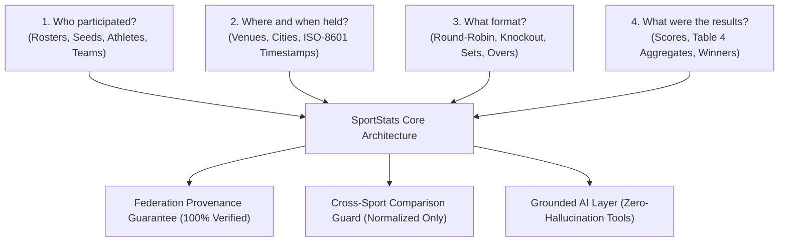
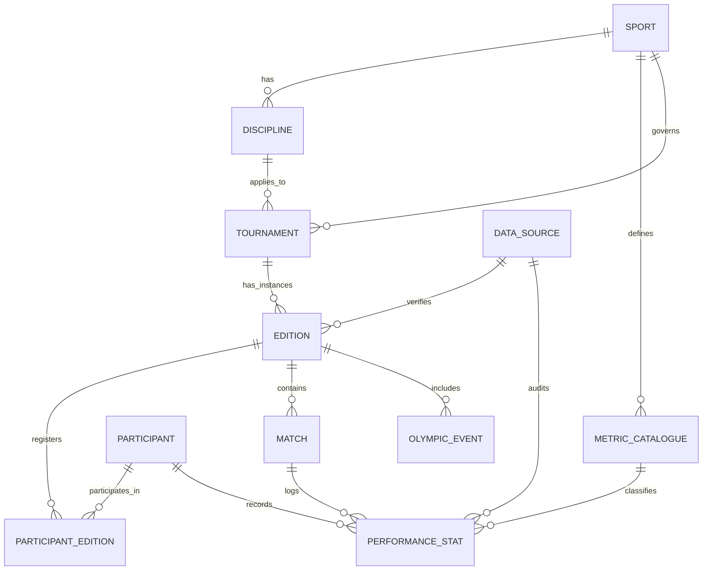

# SportStats Architectural Specification

This document details the software architecture, package structures, relational models, and data flow pipelines of **SportStats**, implementing the research report *"SportStats – An AI-Enabled Global Sports and Performance Tracker"*.

---

## 1. System Overview & The Four Questions

SportStats is engineered to unify 7 international sport disciplines (Cricket, Football, Badminton, Basketball, Tennis, Kabaddi, and Olympic disciplines) under a standardized schema and deterministic analytics engine. The system answers the four core questions for any major sporting event:

---

## 2. Layered Architecture (Research Report Figure 4)

SportStats strictly decouples data storage, deterministic statistical computation, API routing, AI grounding, and UI presentation across five autonomous tiers:

```mermaid
flowchart TD
    subgraph PresentationTier ["1. Presentation Layer (Next.js 14 & Tailwind)"]
        UI_Home["Overview & 4 Questions Hero"]
        UI_Tournaments["Table 2 Edition Tracking & Timeline"]
        UI_Compare["Compare Studio (Cross-Sport Normalization)"]
        UI_Trends["Trends Explorer (Regression & Warnings)"]
        UI_Rankings["Official Rankings Snapshots"]
        UI_Olympics["Olympics Hub (Figure 7 Medal Share)"]
        UI_AI["AI Analyst Interface"]
        UI_Admin["CSV Ingestion & Validation"]
    end

    subgraph GroundedAITier ["2. Grounded AI Layer (Deterministic Dispatch)"]
        AI_Router["POST /api/v1/ai/ask"]
        AI_Intent["Intent Classifier & Safety Guard"]
        AI_Tools["Read-Only DB Dispatch Tools"]
        AI_Prompt["System Prompts & Refusal Invariants"]
    end

    subgraph ServiceTier ["3. Application & REST API Layer (FastAPI)"]
        API_Sports["/sports & /metrics"]
        API_Tournaments["/tournaments & /editions"]
        API_Compare["/compare/players & /compare/tournaments"]
        API_Analytics["/trends, /rankings, /olympics"]
        API_Envelope["Envelope Builder: { data, meta, provenance }"]
    end

    subgraph EngineTier ["4. Statistical Computation Engine (Table 4)"]
        ENG_Formulas["formulas.py (Zero-Division Safe)"]
        ENG_Aggregates["aggregates.py (Mean, Variance, Percentiles)"]
        ENG_Compare["compare.py (Cross-Sport Z-Score Guard)"]
        ENG_Trends["trends.py (OLS Regression Slope & R²)"]
    end

    subgraph StorageTier ["5. Relational Persistence & Ingestion Layer (SQLite / PostgreSQL)"]
        DB_Core["23 Relational Tables (Sport, Tournament, Edition, Match)"]
        DB_Views["5 Analytical Materialized Views (v_tournament_tracking, etc.)"]
        DB_Ingestion["Adapters, Cleaners, Validators & Ingestion Runs"]
        DB_Audit["Audit Logging & Data Quality Issue Registry"]
    end

    PresentationTier --> GroundedAITier
    PresentationTier --> ServiceTier
    GroundedAITier --> ServiceTier
    ServiceTier --> EngineTier
    EngineTier --> StorageTier
```

---

## 3. Common Data Model (Research Report Figure 2)

All 7 sports map directly to a normalized entity-relationship core centered around tournament editions, participants, matches, and metric catalogues:

---

## 4. Ingestion Pipeline & Formula Injection Defense

The ingestion pipeline guarantees data purity through six automated stages:

1. **Source Registry & HTTP Audit:** Captures federation URL, timestamp, HTTP status, and payload checksum.
2. **Formula Injection Sanitization:** Checks all CSV text fields against dangerous prefix characters (`=`, `+`, `-`, `@`, `\t`, `\r`) to eliminate spreadsheet execution vectors.
3. **Data Type & Date Normalization:** Validates ISO-8601 date ranges (`start_date <= end_date`).
4. **Foreign Key Integrity:** Ensures references to sports, tournaments, editions, and participants resolve deterministically.
5. **Quality Issue Logging:** Invalid rows are quarantined in `data_quality_issue` with itemized row-level error reasons without halting overall batch ingestion.
6. **Provenance Attribution:** Every committed record receives an audited `source_id`.

---

## 5. Security & Groundedness Invariants

- **Read-Only Database Transactions:** AI tools run with read-only database connections, eliminating arbitrary SQL injection or unintended state modifications.
- **Explicit Negative Refusals:** When an entity, tournament, or statistic is not present in official federation records, the system responds with an explicit refusal (*"I don't have verified data for that"*) rather than extrapolating.
- **Cross-Sport Comparison Guard:** Raw metrics (runs vs goals) cannot be directly compared; normalized metrics (win %, z-scores, percentiles) are strictly required.

